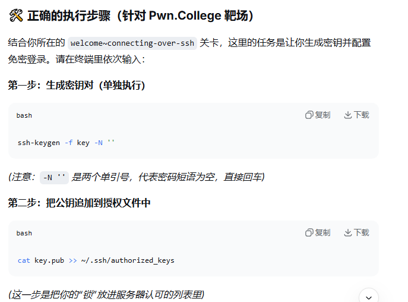
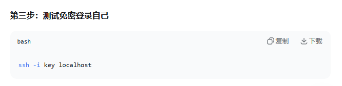
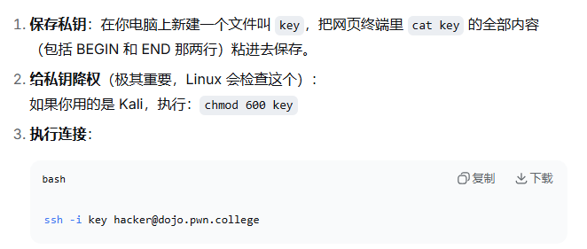

# 1、`ssh-keygen -f key -N '' ` 
## 生成一对SSH密钥;当前目录下会生成两个文件,key(绝密,不能给别人)和key.pub(可以公开)
## `-f key` :指定生成的文件名为key(私钥)和key.pub(公钥)
## `-N ''` :表示不设置密码短语,回车直接生成

# 2、`ssh -i key hacker@dojo.pwn.college`
## 使用指定的私钥登录远程服务器
## `-i key` :指定身份文件,告诉SSH客户端用`key`这个私钥去证明我的身份
## `hacker@dojo.pwn.college` :目标服务器的用户名和地址

# `cat key.pub >> ~/.ssh/authorized_keys` :把公钥追加到授权文件中

# `type key/key.pub` :windows中查看生成的公私钥

# `ssh -i key 用户名@地址` :登录

# `chmod 600 key` :Linux(Kali)中要给私钥降权

 

