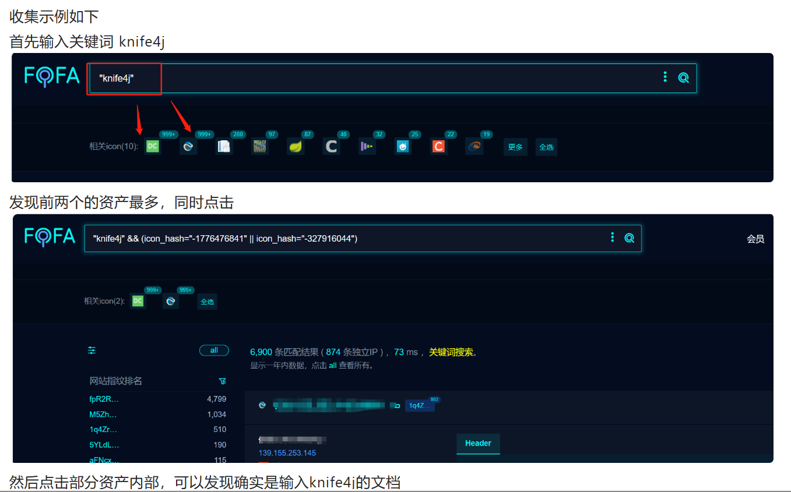
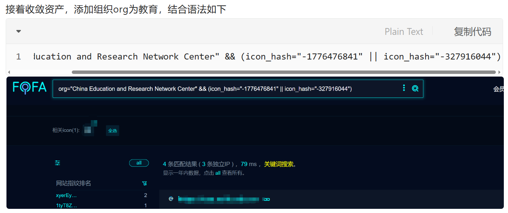
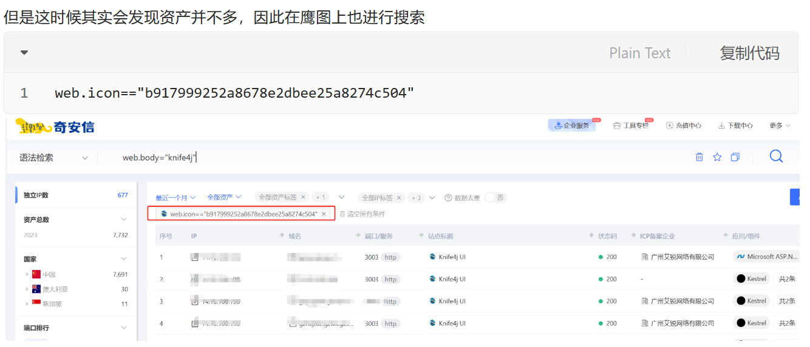
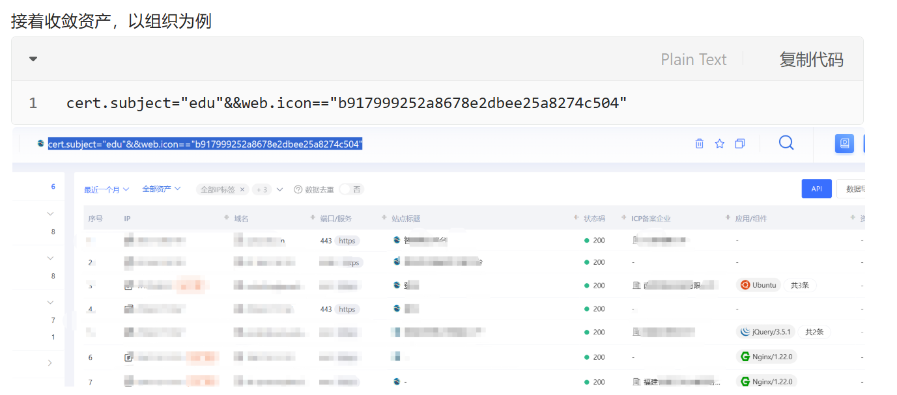

https://bbs.zkaq.cn/t/31137.html#top

# 收集 :knife4j
## 语法 :图标搜索+学校资产
## 通过搜索图标可以发现knife4j接口文档
## 搜索学校资产可以通过org搜索组织等方式

## fofa中输入关键词knife4j

## 发现未授权文件上传点
## 通过上传接口发现会直接暴露上传后的文件路径
## 进行访问会变成下载,说明文件类型在上传之后会被修改
## 构造.html后缀的xss文件;上传后访问路径出发存储xss