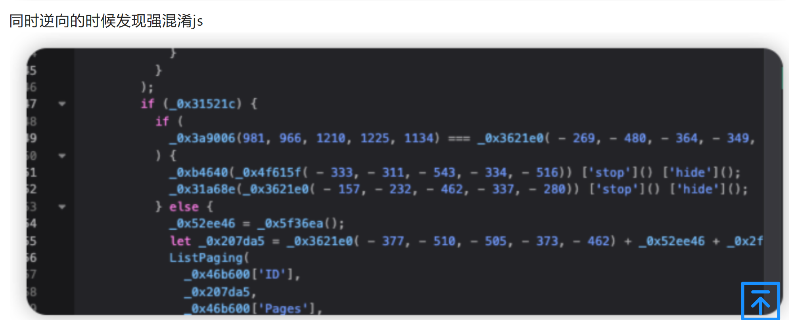
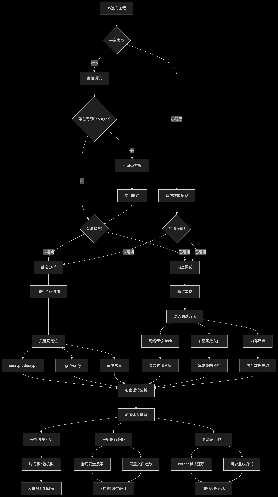

https://bbs.zkaq.cn/t/32399.html#top

# waf无法识别密文,无法拦截

# 在线加解密网站 :https://www.ssleye.com/ssltool/

# 常见的js加密
## 对称加密 :使用的加密和解密密钥都是同一个,一般存储在前端或者后端动态获取,可以直接拿到
## 非对称加密 :加密和解密使用两个密钥,公钥一般在前端,用于加密,私钥放在后端,用于解密

# 靶场 :https://github.com/outlaws-bai/GalaxyDemo,Galaxy插件自带的靶场,下载后启动

# 如何快速定位加密处代码
## 1、通过字段关键字
## 2、通过js关键字
## 3、通过路由
## 4、通过断点

# 案例：https://bbs.zkaq.cn/t/32202.html

# Galaxy :https://github.com/outlaws-bai/Galaxy/releases
## 将burp里的数据解密后重新发送到burp然后再发送给服务器，解密回显再到burp;可联动sqlmap、xray
# 对应的解密脚本 :https://github.com/outlaws-bai/GalaxyHttpHooker
## 注意 :除了对应的key和iv,还需要填入解密的字段,是整个请求的字段则不需要修改,部分加密则需要填写解密的字段,需要有一点编程和排错能力

# 进阶:js逆向
## 案例 :小程序解包(https://mp.weixin.qq.com/s/LPs7F-SjfvG96JAwmS5TsQ)
## webcode :微信小程序反编译工具(https://github.com/biggerstar/wedecode)
## 小程序强开f12(会封号) :https://github.com/JaveleyQAQ/WeChatOpenDevTools-Python
## ida下载及破解 :https://www.52pojie.cn/thread-1970020-1-1.html
## 强混淆js

## 无限debug

# 小程序逆向
## 时间戳:17开头
## 定位加密代码:强特征的字符串
## webpack打包、解包
## mitmproxy :https://github.com/mitmproxy/mitmproxy
### 相当于里一个burp,区别是burp是获取浏览器的流量进行测试;mitmproxy是获取burp的流量进行修改xxx后再次发送

# 逆向js
## 越权

# js逆向思维导图
