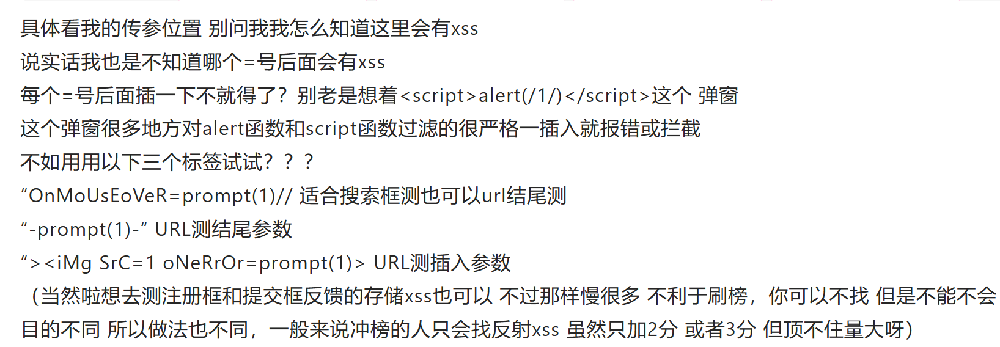
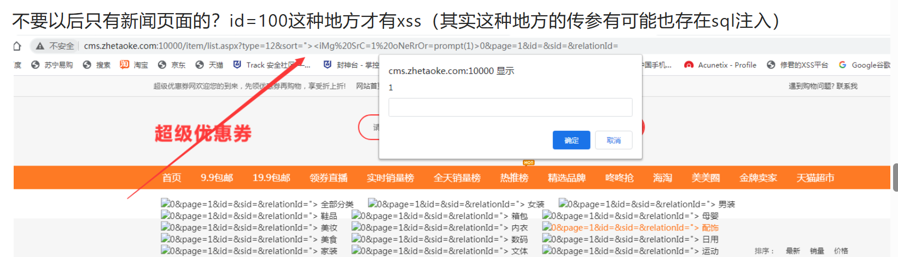

https://bbs.zkaq.cn/t/5065.html

# 谷歌语法 
## inurl:后台管理
## inurl:index.php 

# fofa

# url重放漏洞、CSRF
# url重定向漏洞

# xss

# 页面urlsql注入

# cmd ping -> 得到ip后去fofa搜

# xray :漏扫神器
## webscan —basic-crawler URL