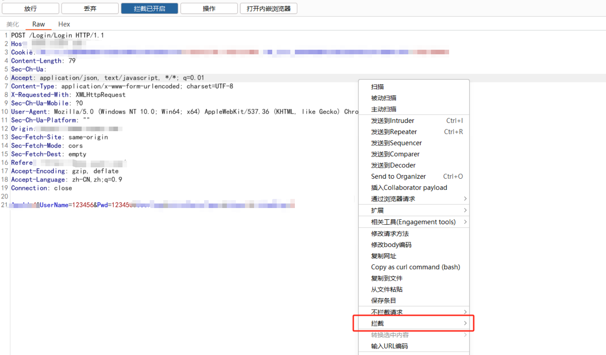
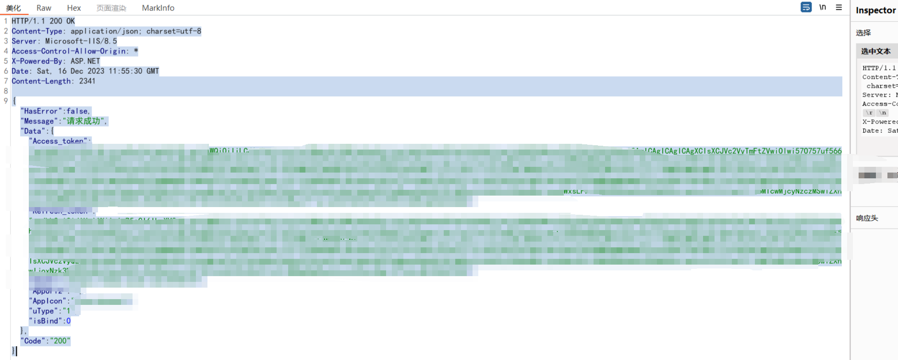

https://bbs.zkaq.cn/t/31435.html#top

# 打点
## 开局一个登录框

# 用户枚举到账号爆破
## 没发现admin的弱口令,但是发现存在用户枚举漏洞,准备跑一下账号
## 输入密码为123456进行账号爆破,成功爆破出账号à,经过测试发现任意密码都可以

# 登录
## 尝试利用账号à进行登录,发现失败,只有通过burp放包才成功
## 复制登录成功后的的jwt包,在登陆处输入任意账号密码,选择拦截

## 将回显修改成刚才获取的内容

## 接触拦截后可以访问成功