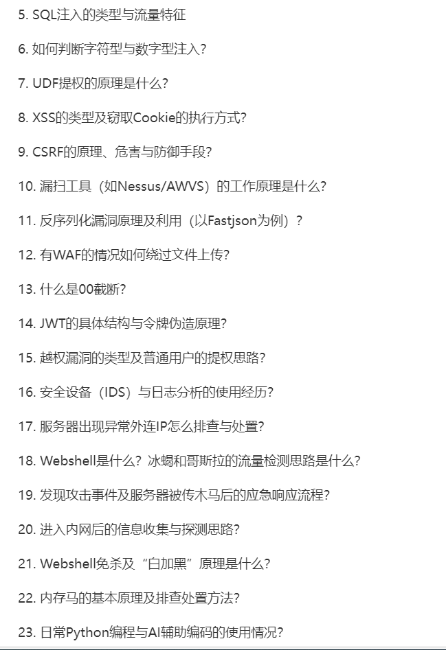
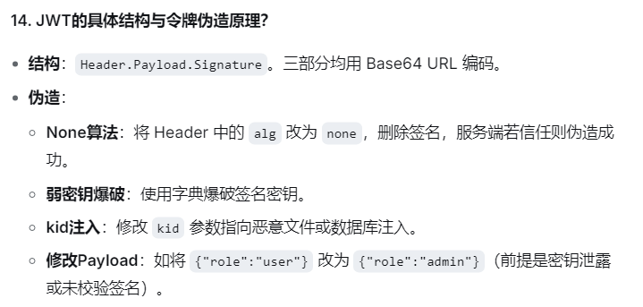

# 5、sql注入的类型与流量特征
## 类型:联合查询注入(Union)、报错注入、布尔盲注、时间盲注、堆叠注入、宽字节注入
## 流量特征:URL或参数中出现 ` ' `、` union select `、` and 1=1 `、` sleep() `等关键词;返回包出现数据库报错信息;响应时间异常变长

# 6、如何判断字符型与数据型注入
## 数字型:` id=1 and 1=1 `(正常)、` id=1 and 1=2 `(异常).参数不需要闭合,直接拼接到SQL语句中
## 字符型:` id=1' and '1'='1 `(正常)、` id=1' and '1'='2`(异常).参数需要闭合引号才能生效

# 7、UDF提权的原理
## UDF(User Defined Function):用户自定义函数
## 前提:MySQL服务以高权限(root或system)运行
## 原理:利用MySQL的`plugin_dir`目录,将恶意的动态链接库(Windows下是DLL,Linux下是SO)写入该目录.然后通过SQL语句`CREATE FUNCTION`创建自定义函数(如`sys_eval`),调用该函数即可执行系统命令,实现提权

# 8、XSS的类型及窃取Cookie的执行方式
## 类型:反射型(非持久)、存储型(持久)、DOM型
## 窃取方式:构造Payload `  ` 诱导用户访问.用户浏览器会带着自己的Cookie请求攻击者的服务器 ,攻击者通过查看服务器日志即可获取Cookie

# 9、CSRF的原理、危害与防御手段
## 原理:跨站请求伪造.攻击者诱导已登录目标网站的用户去访问攻击者构造的恶意页面,利用用户的合法身份(Cookie)向目标网站发送恶意请求
## 危害:修改密码、转账、发帖、添加管理员账号
## 防御:添加CSRF Token、验证Referer头、设置Cookie的SameSite属性、敏感操作要求二次验证(如输入原密码或短信验证码)

# 10、漏扫工具(如Nessus/AWVS)的工作原理
## 原理:基于漏洞特征库(CVE)和Poc(概念验证).扫描器会识别目标的服务、版本、中间件指纹,然后发送特定的探测请求,通过对比响应内容(如报错信息、特定回显),判断是否存在已知漏洞
## CVE(Common Vulnerabilities and Exposures) :通用漏洞披露,漏洞的身份证号

# 11、反序列化漏洞原理及利用(以Fastjson为例)
## 原理:程序在将字节流/字符串反序列化为对象是,会自动调用对象中的特定方法(如getter、setter、构造函数).如果攻击者能控制输入,就能构造恶意的序列化数据,触发恶意代码执行
## Fastjson利用:构造带有`@type`属性的JSON数据,指向恶意类(如`TemplatesImpl`),在反序列化时触发`getter`方法,导致远程代码执行(RCE) 
## RCE(Remote Code Execution) :远程代码执行,危害最高,相当于拿到了服务器的最高控制权

# 12、有WAF的情况下如何绕过文件上传
## 修改`Content-Type`(如改为`image/jpeg`)
## 修改文件头(如添加`GIF89a`)
## 扩展名变形(`php5`、`phtml`、`php.`、大小写混写、双写`pphphp)

# 13、什么是00截断(Null Byte Injection/Null Character Injection)
## 原理:在C语言等底层语言中,`\0`(空字符)代表字符串结束.在PHP5.3.4之前或未受GPC保护时,`%00`可以截断后面的路径或扩展名
## 示例:上传文件名为`shell.php%00.jpg`,后端保存时,以为`%00`被解析为空字符,实际保存为`shell.php`,从而绕过白名单校验
## GPC(Get Post Cookie) :`magic_quotes_gpc`,防御SQL注入和XSS

# 14、JWT的具体结构与令牌伪造原理
## JWT(Json Web Token) :web应用中的身份认证机制,"防伪的电子门票"
## 结构:`Header.Payload.Signature`三部分均用Base64URL编码

# 15、越权漏洞的类型及普通用户的提权思路
## 类型:水平越权(同级用户互看数据)、垂直越权(普通用户执行管理员操作)
## 提权思路:修改请求中的ID(如`user_id=1001`改为1002)、修改API参数(如`role=user`改为`admin`)、越权访问未授权的后台接口

# 16、安全设备(IDS)与日志分析的使用经历
## 思路:通过IDS告警发现异常流量(如高频SSH爆破、web攻击特征);结合系统日志(`/var/log/secure`)和web日志(Access Log)分析攻击源IP、时间、Payload;判断攻击是否成功;进行IP封禁或告警上报

# 17、服务器出现异常外连IP的排查与处理
## 排查:`netstat -antlp`或`lsof -i`查看外连IP;`ps aux`查看可疑进程;`ls -l /proc/PID/exe`查看进程源文件
## 处置:立即断网(防火墙隔离/拔网线);保留证据(内存、日志、样本);杀死恶意进程;修复漏洞;重装系统(如果被提权)
### `netstat -antlp`
#### -a :all
#### -n :numeric
#### -t :tcp
#### -l :listening
#### -p :program
### `lsof(List Open File) -i` :Linux中列出所有的网络连接(TCP/UDP)
### `ps aux` :Linux中列出当前系统中所有正在运行的进程，并显示详细的资源占用和启动信息
#### ps :Process Status
#### a :all
#### u :user
#### x :显示没有控制终端的进程
### `ls -l /proc/PID/exe` :Linux中排查恶意进程时的“终极溯源命令”
#### /proc :Linux的虚拟文件系统,存放内核和进程的实时信息
#### PID :进程ID
#### /exe :软链接,指向启动该进程的原始可执行文件

# 18、webshell是什么?冰蝎和哥斯拉的流量监测思路
## webshell:web后门,通过web服务执行系统命令
## 检测思路:
### 冰蝎:流量经过AES加密,特征为`Content-Type:application/octet-stream`,有固定的密钥协商过程
### 哥斯拉:流量伪装(Base64、异或),特征为强特征密钥、特定加密后的Payload格式.可通过解密流量(配置SSL证书)、检测强特征、行为分析(如异常的命令执行)来检测

# 19、发现攻击事件及服务被传木马后的应急响应流程
## 六步法(PDCERF)
### (1)准备 :确认应急预案、工具包、备用网络
### (2)检测与确认 :接到告警后确认是否真的是入侵;查看EDR告警、waf日志、异常CPU占用或外连流量
### (3)遏制 :最关键的一步;立刻拔网线或禁用网卡(断开内网横向移动),保留现场(不要立刻重启或关机,防止内存中的木马或密钥丢失)
### (4)根除 
#### 查进程与文件 :`ps -aux`、`tasklist`；检查异常外连端口(`nststat -antlp`);查找指向`/tmp`或`C:\Windows\Temp`的可疑进程
#### 查权限维持 :排查定时任务(crontab)、启动项、注册表、服务、内存马
### (5)恢复 :打上相应的补丁、修改密码、重启服务、验证业务正常
### (6)总结 :复盘入侵路径、补充安全策略

# 20. 进入内网后的信息收集与探测思路
## 由单机向内网纵深扩展
### (1)本机信息 :`whoami /all`(当前权限)、`systeminfo`(补丁与系统版本)、`ipconfig /all`、`net user`、`net localgroup`
### (2)网络拓扑 :`route print`(查看路由表)、`arp -a`(查看ARP表)、DNS缓存、找到内网其他网段的入口
### (3)凭据收集 :查看配置文件、浏览器密码、或者直接用Mimikatz抓取内存哈希(如NTML hash)
### (4)域环境探测 :重点
#### 通过`nslookup`查`_ldap`SRV记录找域控
##### SRV(Service Record) :服务定位记录
#### 使用Powershell或PowerView枚举域内所有用户、计算机、组(查找高权限用户)
#### 使用`BloodHound`收集数据并画出攻击路径(找ACL权限配置错误)
### (5)服务扫描与横向 :使用Nmap或CrackMapExec探测内存存活主机,重点找445(SMB)、3389(RDP)、5985(WinRM)、22(SSH)等端口,利用抓到的哈希或密码进行横向移动

# 21、Webshell免杀及"白加黑"原理
## 对抗杀毒软件的特征检测与信任利用
### (1)Webshell免杀
#### 静态免杀 :修改代码特征,加密/混淆(如Base64、异或),或者使用不常见的语言特性(如PHP的反射机制、无字符马)
#### 动态免杀 :分离免杀(代码里只有请求逻辑,真正的恶意代码通过外部加载)、内存马(直接驻留内存)
### (2)"白加黑"原理 :经典的DLL侧加载(DLL Side-Loading)技术;攻击者把恶意DLL伪装成白程序运行必须的依赖DLL,当白程序被启动时,系统会加载恶意的DLL,而杀毒软件看到白程序的合法签名就放行了整个进程(以为是安全软件),从而绕过了查杀
#### 白 :指合法的、有正规厂商数字签名的可执行文件(.exe)
#### 黑 :指恶意的DLL文件
#### DLL(Dynamic Link Library) :动态链接库;Windows系统里的"共享工具箱"或"代码积木";微软为了让软件更小、更省内存，把很多通用的功能（比如弹窗、网络请求、内存分配）做成了 DLL 文件。主程序（.exe）在需要用到这些功能时，再去“借用”这些 DLL，而不是把所有代码都打包在自己身上;在Linux里是`.so`(Share Objext,共享对象)