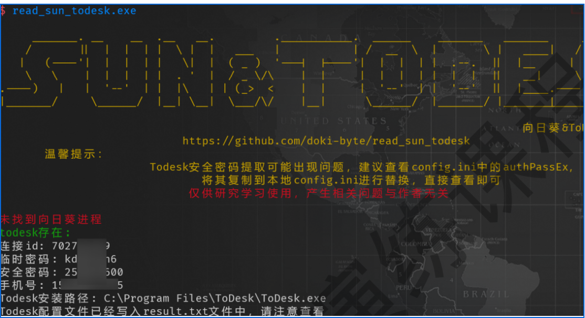

# 目标存在非常牛的杀软导致无法上线CS,但是有远控软件时的做法

# 策略 :利用开源工具窃取远控软件凭证
# 核心思路 :寻找可以在目标主机上执行且不触发杀软告警的工具;目的不是恶意利用系统漏洞,而是读取特定程序的本地存储的配置或内存数据

# 识别目标远控软件和凭证存储位置
## 首先判断目标主机上运行的远控软件是什么(如TeamViewer、AnyDesk、ToDesk),然后研究这些软件是如何存储其连接密码或配置信息的
## (1)本地配置文件 
### 许多远控软件会将密码或连接信息加密存储在本地的配置文件(如`.conf`、`.ini`或注册表项)中
## (2)内存信息
### 正在运行的远控软件进程的内存中可能存在解密后的连接密码或会话密钥



# 原文
```
### 目标存在非常牛的杀软导致无法上线 CS，但是有远控软件怎么做

**策略：利用开源工具窃取远控软件凭证**

核心思路是寻找那些可以**在目标主机上执行**且**不触发杀软告警**的工具，它们的目的不是恶意利用系统漏洞，而是**读取特定程序的本地存储的配置或内存数据**

**识别目标远控软件和凭证存储位置**

首先，需要判断目标主机上运行的远控软件是哪一个（如 **TeamViewer**、**AnyDesk**、**ToDesk** 等），然后研究这些软件是如何**存储其连接密码或配置信息**的

- **本地配置文件：** 许多远控软件会将密码或连接信息加密存储在本地的配置文件（如 `.conf`, `.ini`, 或**注册表项**）中
- **内存信息：** 正在运行的远控软件进程的内存中，可能存在解密后的连接密码或会话密钥


```