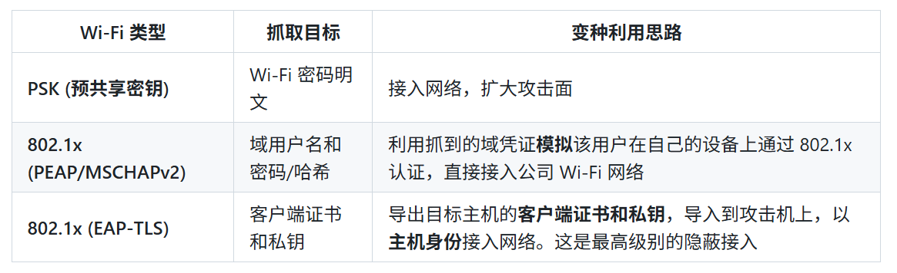

# 抓到域内Windows主机的Wi-Fi密码的利用思路

# 一、扩大网络访问权限与横向渗透
## 1、接入隔离\低安全区域网络
## 很多企业会将不同的设备或用户类型分配到不同的Wi-Fi网络,安全防护等级不一
### (1)利用目标 
### 接入访客网络(Guest Wi-Fi)、运维设备网络、内部loT设备网络(如IP摄像头、智能照明)
### (2)利用价值
### 弱配置设备攻击 
#### 许多连接在Wi-Fi上的设备(如打印机、投影仪、会议系统)存在默认凭证或未打补丁的漏洞,可以作为新的跳板进入更核心的网络
## 2、绕过网络访问控制(NAC)
## 如果企业实施了严格的端口安全或NAC,限制了有线网络的接入
### (1)利用目标
### 使用抓取到的密码,通过自己的设备连接到员工WiFi
### (2)利用价值
#### 物理渗透捷径 :在物理渗透场景中,可以直接在办公区或会议室接入内网,无需寻找空闲的墙上网络端口
#### 规避端口绑定策略 :绕过特定有线端口或MAC地址的限制,相当于为自己生成了一个有效的内网接入身份

# NAC(Network Access Control) :网络准入控制;设备想连内网,先过安检,合格才能进;防火墙是入网之后再拦流量,NAC是入网这一步就拦住,不让进内网

# 二、建立隐蔽C2通道(反向连接)
# Wi-Fi网络可以作为建立持久化和隐蔽命令与控制(C2)通道的基础
## 1、利用Wi-Fi出口建立隐蔽通信
### 思路 :在受控的域内Windows主机上设置代理或路由,强制其C2流量通过Wi-Fi接口进行传输,而非默认的有线网络接口
### 利用价值
#### (1)桡骨核心防火墙 :许多公司的主出口防火墙对有线网络的流量监控及其严格,而WiFi网络的出口策略往往较为宽松(或经过了不同的流量检测设备)
#### (2)增加溯源难度 :攻击者将C2服务器设置在互联网上,受控主机的回连流量通过WiFi接口离开内网,可以混淆安全团队对C2流量的分析和溯源路径
## 2、作为死亡跳板
### 思路 :如果攻陷了多台主机,可以将其中一台主机设置为WiFi网络中的内部C2代理
### 利用价值 :核心主机只需连接到这台WiFi跳板机(内网IP),而不是直接连接到互联网C2服务器;这使得核心资产的通信更加本地化和隐蔽,即使WiFi被切断也不会直接暴露核心主机

# 三、凭证复用与社会工程学
## 1、密码复用攻击
### 思路 :尝试将抓取到的WiFi密码作为低级服务或非核心应用的密码
### 利用价值 :许多员工习惯使用相同的简单密码来保护共享文件夹、测试数据库、内部Wiki站点或个人账户;可以尝试在域内进行哈希传递或密码喷洒等攻击时将此密码加入字典
## 2、社会工程学辅助
### 思路 :进行钓鱼或社工活动时,如果能提到目标企业的WiFi名称和密码,会极大地提高可信度
### 利用价值 :伪装成IT部门发送安全升级通知或网络维护邮件,要求员工提供其他敏感信息,因为已经掌握了他们日常使用的WiFi凭证

# 四、802.1x认证环境下的变种利用
## 如果WiFi采用802.1x认证(依赖域用户凭证而非简单PSK),则利用思路会升级为对802.1x凭证本身的利用


# PSK(Pre-Shared Key) :预共享密钥;通信双方提前约定好同一个秘密,用来做身份校验、加密,对称密钥;家用WiFi


# 原文
```
### 抓取到域内 Windows 主机的 Wi-Fi 密码有什么利用思路

**一、 扩大网络访问权限与横向渗透**

**1. 接入隔离/低安全区域网络**

很多企业会将不同的设备或用户类型分配到不同的 Wi-Fi 网络，安全防护等级不一：

- **利用目标：** 接入 **访客网络 (Guest Wi-Fi)**、**运维设备网络**、**内部 IoT 设备网络**（如 IP 摄像头、智能照明）
- **利用价值：**
  - **弱配置设备攻击：** 许多连接在 Wi-Fi 上的设备（如打印机、投影仪、会议系统）存在默认凭证或未打补丁的漏洞，可以作为**新的跳板**进入更核心的网络

**2. 绕过网络访问控制 (NAC)**

如果企业实施了严格的**端口安全**或 **NAC**，限制了有线网络的接入：

- **利用目标：** 使用抓取到的密码，通过你自己的设备（如笔记本、手机、便携式路由）连接到员工 Wi-Fi。
- **利用价值：**
  - **物理渗透捷径：** 在物理渗透场景中，可以直接在办公区或会议室接入内网，**无需寻找空闲的墙上网络端口**
  - **规避端口绑定策略：** 绕过针对特定有线端口或 MAC 地址的限制，相当于为你自己生成了一个**有效的内网接入身份**

****

**二、 建立隐蔽 C2 通道（反向连接）**

Wi-Fi 网络可以作为建立持久化和隐蔽命令与控制 (C2) 通道的基础

**1. 利用 Wi-Fi 出口进行隐蔽通信**

- **思路：** 在受控的域内 Windows 主机上，设置代理或路由，强制其 C2 流量通过 Wi-Fi 接口进行传输，而非默认的有线网络接口
- **利用价值：**
  - **绕过核心防火墙：** 许多公司的主出口防火墙对有线网络的流量监控极其严格，而 Wi-Fi 网络的出口策略往往较为宽松（或者经过了不同的流量检测设备）
  - **增加溯源难度：** 攻击者将 C2 服务器设置在互联网上，受控主机的回连流量通过 Wi-Fi 接口离开内网，可以**混淆**安全团队对 C2 流量的分析和溯源路径

**2. 作为“死亡跳板”**

- **思路：** 如果你攻陷了多台主机，可以将其中一台主机设置为 Wi-Fi 网络中的**内部 C2 代理**
- **利用价值：**
  - 核心主机只需连接到这台 Wi-Fi 跳板机（内网 IP），而不直接连接到互联网 C2 服务器。这使得**核心资产的通信更加本地化和隐蔽**，即使 Wi-Fi 被切断，也不会直接暴露核心主机

****

**三、 凭证复用与社会工程学**

**1. 密码复用攻击**

- **思路：** 尝试将抓取到的 Wi-Fi 密码作为 **低级服务** 或 **非核心应用** 的密码
- **利用价值：** 许多员工习惯使用相同的简单密码（如 `wifi_password`）来保护共享文件夹、测试环境的数据库、内部 Wiki 站点或个人账户。可以尝试在域内进行**哈希传递**或**密码喷洒**等攻击时，将此密码加入字典

**2. 社会工程学辅助**

- **思路：** 在进行钓鱼或社工活动时，如果能提到目标企业的 Wi-Fi 名称和密码，会极大地**提高可信度**
- **利用价值：** 伪装成 IT 部门发送“安全升级通知”或“网络维护邮件”，要求员工提供其他敏感信息，因为你已经掌握了他们日常使用的 Wi-Fi 凭证

****

**四、 802.1x 认证环境下的变种利用**

如果 Wi-Fi 采用 **802.1x** 认证（依赖域用户凭证而非简单 PSK），则利用思路会升级为对 **802.1x 凭证本身的利用**：

| Wi-Fi 类型                 | 抓取目标            | 变种利用思路                                                 |
| -------------------------- | ------------------- | ------------------------------------------------------------ |
| **PSK (预共享密钥)**       | Wi-Fi 密码明文      | 接入网络，扩大攻击面                                         |
| **802.1x (PEAP/MSCHAPv2)** | 域用户名和密码/哈希 | 利用抓到的域凭证**模拟**该用户在自己的设备上通过 802.1x 认证，直接接入公司 Wi-Fi 网络 |
| **802.1x (EAP-TLS)**       | 客户端证书和私钥    | 导出目标主机的**客户端证书和私钥**，导入到攻击机上，以**主机身份**接入网络。这是最高级别的隐蔽接入 |
```