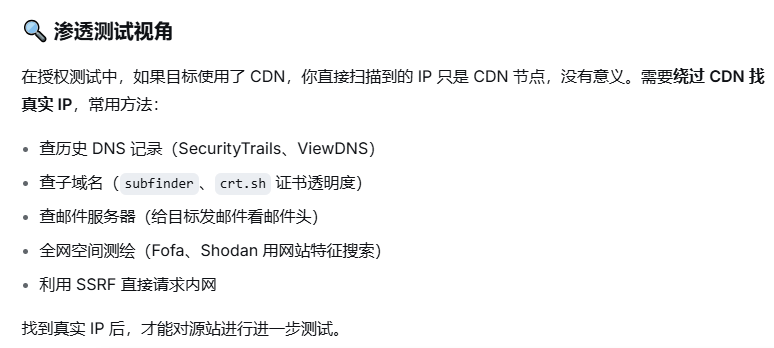

# 如何判断是否使用CDN

## CDN(Content Delivery Network) :内容分发网络
### 一张分布在全球各地的缓存服务器网络,让用户就近获取网站内容,提高访问速度,同时隐藏源站真实IP 

# 1、DNS解析查询
## 核心原理:将请求解析到离你最近的节点服务器
## 多次查询:在不同地区或使用不同的DNS解析服务器(如Google DNS、阿里云DNS)多次对目标域名进行ping或nslookup查询
## 观察IP地址:如果每次查询返回的IP地址都不同,或者返回多个IP地址,那么很可能目标使用了CDN
## 在线工具:`nslookup.io`、ping或nslookup

# 2、http响应头分析
## 很多CDN服务商会在http响应头中添加特定的信息来标识自己
## `Server`字段 :一些CDN会在Server字段中暴露自己的身份,例如