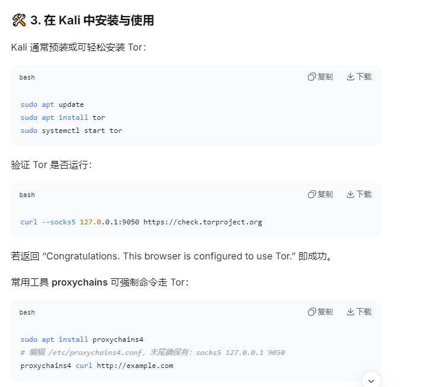

https://mp.weixin.qq.com/s/f-9w9wHEW2ORsRQE2wX07w

# `CT(Certification Transparency)` :证书透明度
## 突破常规子域名爆破局限,实现企业未公开的测试环境、内部系统域名
## 操作:通过crt.sh(https://crt.sh/)、Google CT等平台,输入企业根域名(%.xx.com)或企业邮箱后缀(@xxx.com),筛选包含目标关键词的SSL证书;重点关注证书颁发时间在3个月内的记录,这类资产往往防护较弱;结合whois反查,确认证书绑定的IP是否属于目标网段(注意:需排除第三方合作企业的无关证书,可通过"Organization"字段过滤)

# 基于流量分析的存活主机探测
## 在目标网段禁止ICMP(ping不通)时,精准定位存活主机
## 操作:用Nmap的-sA(ACK扫描)或-sS(半开放扫描),对常见端口(80、443、3389、22)发送探测包;对返回"open"或"filter"的IP进一步用-p-全端口扫描;结合wireshark抓包分析,识别目标网络的TCP指纹(如操作系统特征、防火墙规则),判断主机是否存活
## masscan :极速端口扫描器,在短时间内扫描大网段

# 暗网数据关联分析
## Tor网络(The Onion Router) :匿名通信网络,影藏用户真实IP和访问目标,匿名上网

# WAF绕过 :基于HTTP协议特性的精准绕过
## 突破常见web应用防火墙(如阿里云WAF、Cloudflare)

# 反序列化漏洞 :跨语言利用与内存马注入

# 缓冲区溢出 :DEP与ASLR防护绕过
## DEP(Data Execution Prevention) :数据执行保护
## ASLR(Address Space Layout Randomization) :地址空间布局随机化

# 移动端APP :Frida Hook绕过证书校验

# 云原生漏洞 :K8s API 未授权访问利用