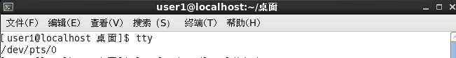
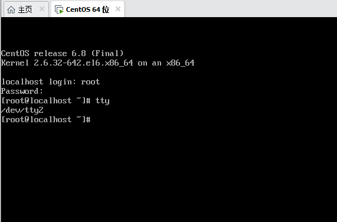

# tty(Teletypewriter) 
## 1、虚拟终端(Virtual Console,简称tty1-tty6) :`/dev/tty2`;在kali的图形界面按下快捷键`Ctrl+Alt+F2(至F6)`会切到一个纯黑底白字的命令行界面,通常有6个
## 2、伪终端(Pseudo-terminal Slave,简称pts/X) :`/dev/pts/0`;在图形化终端窗口显示

